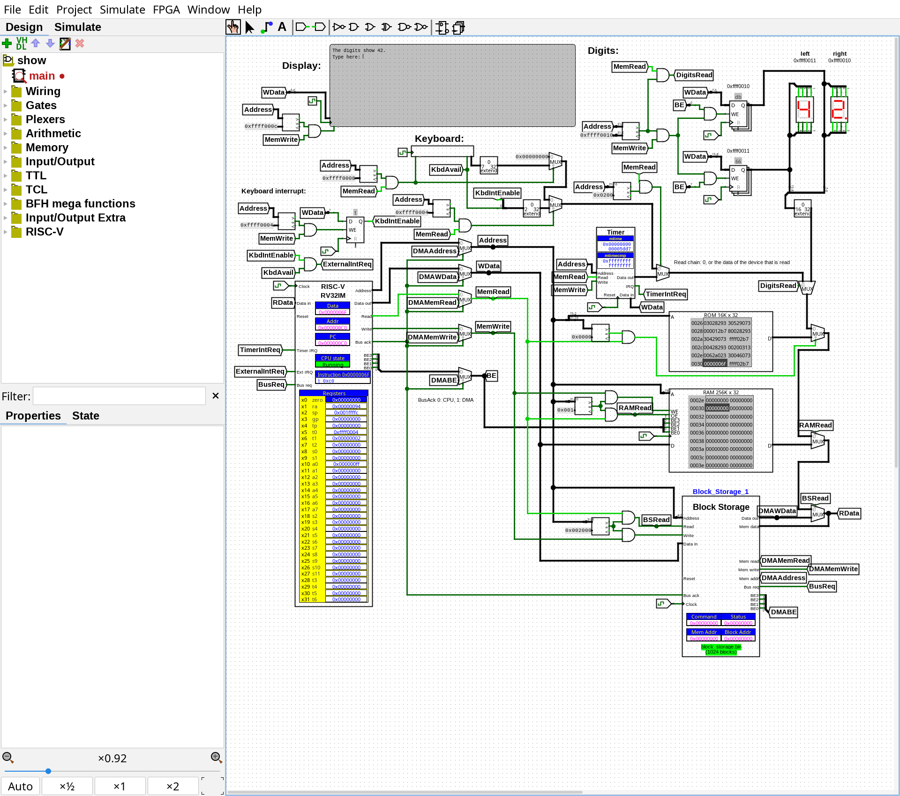

# The simulated computer

`computer.circ` is the computer of *Operating Systems from the Bare Metal Up*: a circuit for
[Logisim Evolution UCD](https://github.com/pavelgladyshev/logisim-evolution-ucd) 5.0.10 or later.
The bare-metal projects of this supplement run on it, and so does logOS. This page is its
reference: the memory map, every device register, the interrupts, the state after reset and the
mapping onto the FPGA board.



## What it is

The circuit is built from the three components of Logisim's *RISC-V* library (the `RV32IM CPU`,
the `Timer` and the `Block Storage`) and from ordinary Logisim parts: a ROM, a RAM, a `TTY`, a
`Keyboard`, two `7-Segment Display`s, three registers, comparators, multiplexers and gates.

- The processor is RV32IM with the Zicsr instructions, and has machine, supervisor and user mode.
  It starts at address 0, the first word of the ROM.
- Every load and store puts its exact byte address on the bus, with four byte enables that say
  which bytes of the addressed word it concerns. The data of a store is in its byte lanes (a byte
  stored at an address that ends in 1 is in bits 15 to 8), and a load takes its lane from the
  whole word that the device gives.
- Each device has a comparator that recognises its addresses. What the processor reads comes
  through a chain of multiplexers that starts with 0, so a load from an address where no device
  answers gives 0. A store to such an address is lost. Neither raises an exception.

## The memory map

| Addresses | Device | Access | Notes |
| --- | --- | --- | --- |
| `0x00000000`–`0x0000FFFF` | ROM, 64 KB | read | 2^14 words. The component is labelled `ROM_1`. |
| `0x00100000`–`0x001FFFFF` | RAM, 1 MB | read, write | 2^18 words, with byte enables. |
| `0x00200000`–`0x00200013` | Block storage | see below | Five registers of 32 bits. |
| `0x02004000`, `0x02004004` | Timer: `mtimecmp` | read, write | Low and high word. |
| `0x0200BFF8`, `0x0200BFFC` | Timer: `mtime` | read, write | Low and high word. |
| `0xFFFF0004` | Keyboard: receiver control (RCR) | read, write | |
| `0xFFFF0008` | Keyboard: receiver data (RDR) | read | |
| `0xFFFF000C` | Terminal: transmitter data | write | |
| `0xFFFF0010` | Right seven-segment digit | read, write | One byte. |
| `0xFFFF0011` | Left seven-segment digit | read, write | One byte. |

The ROM is selected when address bits 31 to 16 are 0, the RAM when bits 31 to 20 are `0x001`,
the block storage when bits 31 to 8 are `0x002000`, and the Timer is offered every address from
`0x02000000` to `0x0200FFFF` and compares the whole address itself. The keyboard and the terminal
compare the whole address. The digits are selected when address bits 31 to 2 are those of
`0xFFFF0010`, and the byte enables choose between them.

## The device registers

### Terminal

Logisim's `TTY`, 80 columns by 12 rows.

| Address | Register | Width | Access | Meaning |
| --- | --- | --- | --- | --- |
| `0xFFFF000C` | transmitter data | 7 bits | write | Bits 6 to 0 are a character code; the character appears at the next rising clock edge. There is no status register: the terminal is always ready. |

### Keyboard

Logisim's `Keyboard`, which keeps the characters typed in a buffer of 32.

| Address | Register | Width | Access | Meaning |
| --- | --- | --- | --- | --- |
| `0xFFFF0004` | receiver control (RCR) | 2 bits | bit 0 read, bit 1 read and write | Bit 0 is 1 while a character is waiting. Bit 1 is the interrupt enable: while it is 1 and a character is waiting, the keyboard requests an external interrupt. The other bits read as 0. |
| `0xFFFF0008` | receiver data (RDR) | 7 bits | read | Bits 6 to 0 are the oldest character in the buffer. Reading the register removes that character. It reads as 0 when no character is waiting. |

A store to `0xFFFF0004` (`sw`, `sh` or `sb` at that address) sets the interrupt enable to bit 1 of
the value stored, and changes nothing else. Stores to `0xFFFF0005`, `0xFFFF0006` and `0xFFFF0007`
do nothing.

### Seven-segment digits

Two 8-bit registers, each driving a `7-Segment Display`: the right digit at `0xFFFF0010` and the
left digit at `0xFFFF0011`. A bit that is 1 lights its segment:

```
        a                bit 0   a     bit 4   e
      -----              bit 1   b     bit 5   f
   f |     | b           bit 2   c     bit 6   g
     |  g  |             bit 3   d     bit 7   the decimal point
      -----
   e |     | c
     |     |
      -----  . point
        d
```

| Digit | 0 | 1 | 2 | 3 | 4 | 5 | 6 | 7 | 8 | 9 |
| --- | --- | --- | --- | --- | --- | --- | --- | --- | --- | --- |
| Byte | `0x3f` | `0x06` | `0x5b` | `0x4f` | `0x66` | `0x6d` | `0x7d` | `0x07` | `0x7f` | `0x6f` |

| Address | Register | Width | Access | Meaning |
| --- | --- | --- | --- | --- |
| `0xFFFF0010` | right digit | 8 bits | read, write | The segments of the right digit. |
| `0xFFFF0011` | left digit | 8 bits | read, write | The segments of the left digit. |

`sb` at either address writes that digit and leaves the other as it is. `sh` or `sw` at
`0xFFFF0010` writes both: the right digit from bits 7 to 0 of the value and the left digit from
bits 15 to 8. `lbu` reads one digit back; `lhu` and `lw` at `0xFFFF0010` read both, the left digit
in bits 15 to 8. Bytes `0xFFFF0012` and `0xFFFF0013` of the word hold nothing: stores to them are
lost and they read as 0.

### Timer

The `Timer` component is the RISC-V machine timer. Both its registers have 64 bits, in two words.

| Address | Register | Width | Access | Meaning |
| --- | --- | --- | --- | --- |
| `0x0200BFF8`, `0x0200BFFC` | `mtime`, low and high word | 64 bits | read, write | Counts up by one at every rising edge of the clock. |
| `0x02004000`, `0x02004004` | `mtimecmp`, low and high word | 64 bits | read, write | The Timer requests an interrupt while `mtime` is greater than or equal to `mtimecmp`, both unsigned. |

A program sets `mtimecmp` with the three stores of the RISC-V specification (all ones to the low
word, the new high word, the new low word) before it enables the timer interrupt, and takes the
request down by writing a later time.

### Block storage

The `Block Storage` component is a disk of 512-byte blocks, kept in the file `block_storage.bin`
beside the circuit, that moves whole blocks to and from the RAM by direct memory access. If the
file is not there when the simulation starts, the simulator makes an empty one.

| Address | Register | Width | Access | Meaning |
| --- | --- | --- | --- | --- |
| `0x00200000` | command | 32 bits | read, write | Writing 1 reads a block from the disk into memory, writing 2 writes a block from memory to the disk. |
| `0x00200004` | memory address | 32 bits | read, write | The address in the RAM of the 512-byte buffer. |
| `0x00200008` | block address | 32 bits | read, write | The number of the block, counted from 0. |
| `0x0020000C` | status | 32 bits | read | Bit 0 busy, bit 1 error. |
| `0x00200010` | result | 32 bits | read | 0 after a command that was accepted, 1 after one that failed. |

## The interrupts

The processor has two interrupt request inputs. It copies their levels into `mip` at every step,
and software cannot clear the two bits: they follow the wires.

| CPU input | Driven by | Bit of `mip` and `mie` | `mcause` | Taken down by |
| --- | --- | --- | --- | --- |
| *Timer IRQ* | the Timer's request (`mtime` ≥ `mtimecmp`) | 7 (`MTIP`, `MTIE`) | `0x80000007` | writing a later time into `mtimecmp` |
| *Ext IRQ* | the keyboard: a character is waiting and bit 1 of RCR is 1 | 11 (`MEIP`, `MEIE`) | `0x8000000B` | reading RDR until no character waits, or clearing bit 1 of RCR |

An interrupt is taken, between two instructions, when its bit is 1 in both `mip` and `mie` and
either `mstatus.MIE` (bit 3 of `mstatus`) is 1 or the processor is in a mode below machine mode.
Both requests are levels: if the handler returns without taking the request down, the interrupt
is taken again at once. A keyboard handler that reads one character from RDR is entered once for
each character typed.

## The state after reset

When the simulation starts:

- the program counter is 0, the processor is in machine mode, `mstatus.MIE` is 0, and `mie`,
  `mip` and `mcause` are 0, so no interrupt can be taken;
- `mtime` is 0 and counts from the first clock cycle; `mtimecmp` is all ones
  (`0xffffffff ffffffff` in the Timer's box), so the Timer requests nothing;
- the keyboard's interrupt enable is 0 and its buffer is empty: RCR reads 0;
- both digits are 0: every segment is off;
- the RAM holds zeros.

## One file for the bare-metal projects and for logOS

The ROM of `computer.circ` is empty: every word of it is 0, which is not an instruction. Run as
it is, the processor takes an illegal-instruction exception (`mcause` 2) at address 0, and because
`mtvec` is 0 as well, the exception's handler is that same word: the computer repeats the
exception for ever and prints nothing.

A program gets into the ROM in a copy of the file, never in `computer.circ` itself:

- each bare-metal project's Makefile writes a copy of the circuit with the program's image in the
  ROM labelled `ROM_1` (`make run`, `make gui`, `make debug`; `tools/mkcircuit.py` does it);
- in text mode the simulator can also load an image itself:
  `java -jar logisim-evolution-ucd-5.0.10-all.jar computer.circ --tty raw --load image.txt ROM_1`;
- logOS puts its bootloader there in the same way.

logOS needs nothing of the two additions to its own circuit: it never sets the keyboard's
interrupt enable, so *Ext IRQ* stays 0 as before, and it does not use the digits. Belfield,
Blackrock and Glendalough, each with its own bootloader in the ROM, give the same sessions on this
circuit as on the circuits of their own trees (`tests/logos.sh`).

## On the FPGA board

The circuit carries its mapping onto the Sipeed Tang Nano 20K, for Logisim's FPGA flow, with
Logisim's ticks at 2048 kHz:

| Component | On the board |
| --- | --- |
| `TTY_1` | the USB serial port's transmit line (pin 69) |
| `Keyboard_1` | the USB serial port's receive line (pin 70) |
| `RAM_1` | the 8 MB SDRAM inside the FPGA's package |
| `Block_Storage_1` | the microSD card in the TF slot (pins 84, 83, 82 and 81) |
| `Digit_Right`, segments a to f | the six LEDs, LED0 to LED5 (pins 15 to 20) |
| `Digit_Right`, segment g and the decimal point; `Digit_Left` | not connected |

The board has no seven-segment display, and the flow does not accept a component that is not
mapped. So the six LEDs show bits 0 to 5 of the byte at `0xFFFF0010`, an LED being lit while its
bit is 1, and the other ten segments are mapped as not connected. The two registers are there all
the same: a program reads back what it wrote. Real displays would need the segments mapped to
pins of the board's headers instead.

Logisim 5.0.10's flow builds the circuit for the board's GW2AR-18 (`tests/fpga.sh`). The ROM's
contents become logic, so the size depends on the program: with the ROM empty the circuit takes
9060 of the 20736 LUTs, and with logOS Glendalough's bootloader in the ROM about 10,700, with 3068
flip-flops either way. The two additions cost 128 LUTs and 18 flip-flops. The highest clock
frequency that nextpnr reports is between 60 and 73 MHz, depending on the program, and the slowest
path is inside the processor; the board's clock is 27 MHz.

Checked on a Tang Nano 20K on 21 November 2026: logOS Glendalough boots on this circuit and passes
its ten test programs, with the session that it has on the circuit of its own tree, and
`tests/kbdirq.S`, with its characters typed over the serial port, prints on the board what it
prints in Logisim.

## Tests

`tests/` has the programs and scripts that check what this page says; `make test` there runs the
quick ones in Logisim's text mode.

| Test | What it checks |
| --- | --- |
| `digits.S` | the two digits, written with `sb`, `sh` and `sw` and read with `lbu`, `lhu`, `lw`, `lb` and `lh` |
| `kbdirq.S` | the interrupt enable bit, and the keyboard interrupt: the handler echoes what is typed while the main program counts on the digits |
| `timer.S` | the Timer's registers after reset, and the timer interrupt |
| `gdb` (in `run_tests.py`) | `mip`, `mie`, `mcause` and `mstatus` in the keyboard's interrupt handler, read with gdb |
| `empty` (in `run_tests.py`) | what the computer does with nothing in its ROM |
| `logos.sh` (`make logos`) | logOS Belfield, Blackrock and Glendalough: the same sessions as on their own circuits |
| `screenshot.sh` (`make screenshot`) | the picture above |
| `fpga.sh` (`make fpga`) | Logisim's FPGA flow for the board, without loading it |
